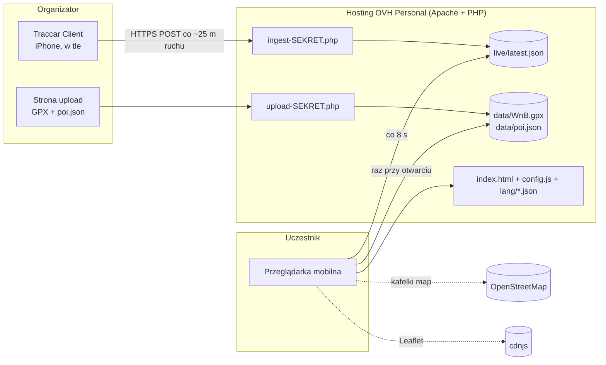

# ARCHITECTURE: mapa przejazdu rolkowego

Stan na 2026-11-20. Opisuje to, co jest zbudowane i przetestowane. Decyzje i ich uzasadnienia: `DECISIONS.md`.

## 1. Przegląd

Bezstanowe, darmowe rozwiązanie bez bazy danych: telefon Organizatora wysyła pozycję na zwykły hosting, hosting zapisuje ją do małego pliku JSON, a przeglądarki Uczestników odpytują ten plik i rysują wszystko na mapie.



Cechy: brak logowania Uczestników, brak bazy danych, pozycje Uczestników nigdzie nie są wysyłane ani zapisywane, jedyne dane „na żywo" to jeden plik `latest.json`.

## 2. Komponenty

| Komponent | Technologia | Rola |
|---|---|---|
| Traccar Client | aplikacja iOS (darmowa) | wysyła pozycję WnB w tle: High, Distance 25 m, bufor offline, heartbeat co ok. 5 min na postoju |
| `ingest-<sekret>.php` | PHP | przyjmuje POST, waliduje, aktualizuje `live/latest.json` |
| `live/latest.json` | plik statyczny | bieżąca pozycja i ogon 120 s |
| `upload-<sekret>.php` | PHP | formularz wgrywania/usuwania trasy i POI, walidacja, kopie `.prev` |
| `data/WnB.gpx`, `data/poi.json` | pliki statyczne | bieżąca trasa i punkty |
| `index.html` + `config.js` + `lang/*.json` | HTML/JS, Leaflet 1.9.4 | cała logika po stronie przeglądarki |
| `.htaccess` | Apache | brak listingu, blokada `*.lock/.tmp/.log/.prev`, `nosniff`, `no-cache` dla `latest.json` |
| Hosting | OVH Personal (Apache, PHP 8.5, FTP, SSL) | bez CDN, bez procesów w tle |

Zewnętrzne zależności: kafelki OpenStreetMap (bez gwarancji dostępności, wymagany Referer i atrybucja), cdnjs (Leaflet), MapMyRun (tylko do rysowania trasy), aplikacja Traccar Client.

## 3. Przepływy danych

**Pozycja WnB.** Traccar wysyła POST (`id, lat, lon, timestamp, accuracy, speed [węzły], altitude, batt…`). `ingest`: przyjmuje tylko POST i treść do 4 KB; ignoruje (odpowiada 200) żądania bez poprawnej pozycji, z czasem z przyszłości (> 300 s) lub starszym niż doba; przyjmuje tylko punkty nowsze od ostatniego; dopisuje punkt do ogona i przycina go do 120 s liczonych **od ostatniego punktu** (max 80 punktów); zapisuje atomowo (plik tymczasowy + `rename`, blokada `flock`); przy błędzie zapisu zwraca 500, żeby aplikacja ponowiła wysyłkę z bufora. Poziom baterii nie jest publikowany.

```json
{"last":{"lat":52.209466,"lon":21.020395,"ts":1794776711,"acc":14,"speed_kmh":5.0},
 "tail":[[52.208602,21.01436,1794776594], …]}
```

**Strona.** Po otwarciu: język, trasa (`data/WnB.gpx`, pierwszy `trk`, kolejne identyczne punkty pomijane), punkty POI (tylko gdy jest trasa), start lokalizacji Uczestnika. Potem co 8 s pobranie `latest.json` (`?t=…`, `cache: no-store`); wiek pozycji liczony względem czasu serwera z nagłówka `Date`, a nie zegara telefonu. Pojedynczy błąd pobrania jest ignorowany, komunikat o braku połączenia po 2 z rzędu.

**Trasa.** `upload` waliduje plik przed zapisem (poprawny XML, `trk` z ≥ 2 różnymi punktami, współrzędne, ≤ 5000 punktów, ≤ 2 MB, brak DOCTYPE/ENTITY; POI: lista, znany typ, pozycja, `km`), kopiuje poprzednią wersję do `.prev` i podmienia plik atomowo. Nowy GPX bez nowego `poi.json` usuwa punkty. Brak pliku trasy (404) to stan celowy: strona pokazuje tylko pozycję WnB.

## 4. Logika po stronie przeglądarki (wszystko w `index.html`)

- **Stany WnB** (czas od ostatniej pozycji): do 15 s prędkość; powyżej dopisek „X temu"; po 90 s (jechał) „Prawdopodobny postój"; po 480 s „Brak sygnału" (szary znacznik); po 900 s „Udostępnianie zakończone". „Postój" = ostatnia prędkość < 2 km/h lub jej brak (heartbeat). Wszystkie progi w `config.js`.
- **Postęp WnB na trasie (km).** Dla każdego punktu ogona wyznaczane są kandydackie miejsca trasy w promieniu 200 m (po jednym na odrębny fragment, różnica > 150 m). Wybór rozstrzyga ścieżka o minimalnym koszcie (algorytm Viterbiego): odległość od trasy + zgodność przyrostu km z faktycznie przebytą drogą + zgodność kierunku jazdy z kierunkiem odcinka. To rozstrzyga trzy skrzyżowania trasy i start = meta.
- **ETA.** Cele to POI z `km` oraz meta. Prędkość: długość drogi z ogona / czas. ETA pokazywane tylko gdy WnB jedzie (ostatnia prędkość ≥ 2 km/h, dane nie starsze niż 90 s), z tyldą i zaokrąglone (powyżej 10 min do 5 min). Stany: „WnB jest tutaj" (≤ 100 m od punktu i stoi), „WnB stoi", brak etykiety, dopóki ogon nie wyjedzie poza kilometr ostatniego punktu.
- **Znaczniki POI.** Kółko z ikoną leży obok punktu, a ogon wskazuje dokładne współrzędne. Kierunek wybierany spośród 16 tak, by kółko było jak najdalej od trasy (przeliczany przy każdym przybliżeniu).
- **Kilometr po dotknięciu trasy.** Najbliższe odcinki w pikselach (22 px); trafienia liczone jako różne miejsca dopiero gdy dzielą je ≥ 4 promienie dotknięcia (min. 150 m), dzięki czemu zakręty nie dają dwóch wartości, a prawdziwe skrzyżowania tak.
- **Strzałki kierunku** co 110 px wzdłuż trasy (rysowane tylko w okolicy widoku), start i meta jako osobne znaczniki.
- **Poświata** przy brzegu ekranu w stronę WnB, gdy jego znacznika nie widać.
- **Pozycja Uczestnika:** `watchPosition` (wysoka dokładność), niebieska kropka z kołem dokładności. **Kierunek:** w ruchu (≥ 1,5 m/s) z GPS, po zatrzymaniu (po 3 s) z kompasu telefonu (iPhone: `webkitCompassHeading` po zgodzie, Android: czujnik absolutny), z poprawką deklinacji (config).
- **Języki:** PL i EN z plików `lang/*.json`, wybór z ustawień telefonu i w menu (hamburger), tam też informacja o prywatności.

## 5. Bezpieczeństwo i prywatność

| Zagrożenie | Zabezpieczenie |
|---|---|
| Obca osoba wysyła fałszywą pozycję | adres `ingest` zawiera sekret (≥ 24 znaki); wymiana sekretu opisana w `RUNBOOK.md` |
| Obca osoba podmienia trasę | adres `upload` zawiera sekret; jedna kopia `.prev`; walidacja wgrywanych plików |
| Złośliwy lub uszkodzony plik | limity rozmiaru, walidacja XML/JSON, odrzucenie DOCTYPE/ENTITY, zapis tylko pod stałymi nazwami, atomowa podmiana, wszystkie wyjścia escapowane |
| Wyciek sekretu przez nagłówek Referer | strona `upload`: `Referrer-Policy: no-referrer`, `noindex` |
| Pliki robocze i logi dostępne z internetu | `.htaccess` blokuje `*.lock, *.tmp, *.log, *.prev`, wyłączony listing katalogów |
| Sekret w publicznym repozytorium | w repozytorium tylko wzorce `ingest-ZMIEN-MNIE.php` i `upload-ZMIEN-MNIE.php` |

Prywatność: pozycja Uczestnika nie opuszcza jego telefonu. Strona nie ustawia ograniczeń Referer (wymaga tego OSM). Zewnętrzne serwery (OSM, cdnjs) widzą adres IP i oglądany fragment mapy. Serwer zapisuje standardowe logi dostępu (informacja w menu strony).

## 6. Wydajność i testy (OVH Personal)

| Test | Wynik |
|---|---|
| 150–200 jednoczesnych odczytów `latest.json` co ok. 8 s + zapisy co 5 s, 6 min | 0 błędów HTTP, p95 odczytu 53 ms, zapisu 77 ms, max 176 ms; 1 niepoprawny odczyt na 6898 (obsłużony tolerancją błędu na stronie) |
| 400 wejść na stronę (200 w 20 s + 200 jednocześnie) | 0 błędów, p95 187 ms, max 364 ms |
| Traccar Client w terenie (2 h 14 min, 614 punktów) | co 6–8 s w jeździe, opóźnienie ≤ 5 s, dokładność 6–14 m, ok. 7 pp baterii na godzinę |

Rozmiary: `latest.json` ok. 2 KB, jedno wejście na stronę ok. 45 KB z serwera (Leaflet i kafelki z innych serwerów).

## 7. Struktura repozytorium i wdrożenie

```
docs/     dokumenty
site/     kopia 1:1 do katalogu głównego strony (index.html, config.js, .htaccess, lang/, data/)
server/   wzorce skryptów PHP (bez sekretów)
tools/    testy i symulator (k6)
```

Wdrożenie ręczne przez FTP (prawdziwe skrypty z sekretem w nazwie istnieją tylko na serwerze). Środowisko testowe: folder `wnb`. Docelowy adres: do wyboru na końcu prac.

## 8. Ograniczenia i ryzyka

- Kafelki OSM nie mają gwarancji dostępności i mogą zostać zablokowane (zmiana `TILE_URL`; PMTiles na OVH sprawdzone jako możliwa alternatywa, nieużywane).
- Na postoju pozycja WnB odświeża się co ok. 5 minut (heartbeat Traccar), więc „Postój" opiera się na ostatniej prędkości.
- ETA jest szacunkiem: nie uwzględnia świateł, postojów i zdarzeń.
- Kierunek z kompasu zależy od telefonu i kalibracji; iPhone wymaga zgody po dotknięciu; sprawdzony tylko matematycznie, do potwierdzenia w terenie.
- Przeglądarka Uczestnika wstrzymuje stronę po wygaszeniu ekranu.
- Zależność od jednego hostingu współdzielonego, bez monitoringu.
